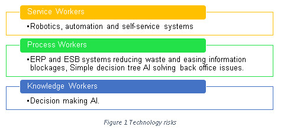

Oringinally published on LinkedIn here:
[LinkedIn Article]("https://www.linkedin.com/pulse/google-ai-wins-go-you-just-lost-your-job-arjuna-vijayanayagam/")

Recently (27/05/2017) Ke Jie the world’s top GO player got stomped 3-0 by Google’s Alpha GO.

So what I hear you say? It’s true that AI has been beating us at our own games, Deep Blue beet Gary Kasparov in chess in 1997.

What makes the Alpha GO win phenomenal is that to win GO the AI needed to think, not just present the best move for a particular scenario based on a large book of possible moves. The game of GO, because of its rules, does not lend itself well to an usual trick of AI programmers use to win games called a “decision tree walk”. The decision tree walk technique is to know all possible moves in a, and to choose the best move correlating to the current board configuration. Alpha GO on the other hand was taught the rules for GO and got better by playing it a lot of times, much like a human.

In fact Alpha GO has played against slightly different copies of itself many millions of times, with the best version surviving and spawning a new generation of slightly different AI. This has resulted in a neural network finely tuned to creating novel strategies to win the game of GO. It is so good at GO that some of its moves have never been seen before. Fan Hui the 2nd Dan GO champion and French national GO team coach was beaten by Alpha GO last year described the 37th move in his second game the AI as “… not a human move. I’ve never seen a human play this move,” he described it as “So beautiful.” It’s a word he kept repeating. Beautiful. Beautiful. Beautiful.

Why is this a risk to your job? To understand this one must recognise that there are 3 types of jobs in a workplace: 1) Service, 2) Process and 3) Knowledge. Each one of these types is at varying levels of maturity of being threatened by technology.

Service workers have been at the forefront bearing the brunt of the technological revolution for the last 4 to 5 decades. Automation in production lines, at the checkout, online retail self-service websites have all eroded this segment of the workforce. This has resulted in a glut in workforce targeted towards servicing client needs.

Process workers are well into being pushed out of work technology. The roll out of software that allows an organization to use a system of integrated applications (ERP and ESB software) have helped organisations manage the business and automate many back office functions related to technology, services and human resources. Resulting in reduction in need for many back office roles. Already simple decision tree AI is replacing humans as cost or labour rises (link and link).

Until now the creative knowledge workers have been safe. We have believed that AI will not be able to formulate strategy to develop plans or write code. But now Alpha GO is proving that this is not the case. That Knowledge workers are the next in line to be replaced. We are on the track to having AI set strategy for organisation with an unwavering focus and a cost base 100 to 1000 of times cheaper than equivalent human workers.

This new paradigm will require one to be creative, to identify and provide services that have yet to be taken over by AI and automation. There will come a time however, where we as a society will have to work out how we are going to remunerate people because, for the most part we would have succeeded in getting machines to do most of our work.
