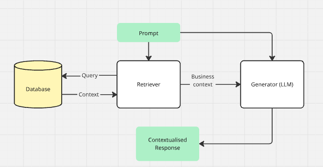

## Intro

Imagine a smart student who's an expert at a subject, but sometimes they need to research the very latest information to answer a question accurately.

That's essentially what Retrieval-Augmented Generation (RAG) does for an AI. An LLM, like the smart student, has a lot of general knowledge. However, when you give it a specific question, a RAG system first acts like a librarian. It quickly searches a set of your documents (like a company's internal files or a specific knowledge base) to find the most relevant information. (1)

Once it finds the right information, it gives that information to the AI. The AI then uses this new, specific context to generate a precise answer, making its response more accurate and up-to-date. This process helps the AI avoid making things up and ensures its answers are based on real, verifiable sources.

### How a rag actually works

The magic of RAG is in its two key components: a retriever and a generator.

- The Retriever: This is your intelligent librarian. Its job is to quickly scan your knowledge base which could be a database of internal documents, product manuals, or research papers to find the most relevant information. The retriever uses a sophisticated method to understand the meaning behind the query and the documents, ensuring it pulls the most semantically similar information, even if it doesn't match a single keyword.
- The Generator: This is the LLM you're already familiar with. But instead of relying only on its pre-trained knowledge, it now has a crucial new piece of information: the documents the retriever just found. The LLM uses this new context as its source of truth to formulate a precise, factual, and comprehensive answer.

This process ensures the output is not just coherent, but also accurate and relevant to the user's specific request, and most importantly reduces the risk of LLM hallucinations. (2), (3).

## The Big Benefits for Businesses

Implementing a RAG system offers significant advantages, especially for business leaders.

Goodbye Hallucinations, Hello Accuracy. By forcing the LLM to ground its response in specific, verifiable documents, RAG drastically reduces the chances of the model making things up. This is a massive win for any field where accuracy is non-negotiable like healthcare, finance, or legal services.
Your Data, Your Expert. RAG gives your AI access to new, domain-specific information it was never trained on. A new hire could ask the system a question about company policy or product specs, and the RAG model would pull the answer directly from the latest documents. It turns your existing data into a dynamic, knowledgeable assistant.
A Smarter, Cheaper Way to Stay Current. Constantly retraining a massive LLM is incredibly time-consuming and expensive. With RAG, you don't have to. You just update your external knowledge base with new documents, and the system automatically incorporates that new information. It's an agile and cost-effective alternative.
Building Trust Through Transparency. Because RAG uses specific documents to generate a response, it can often provide citations or links to the source material. This allows users to easily verify the information, which is crucial for building trust in AI and moving away from the "black box" problem.

The Forbes article on RAG in my reference is an excellent article in simple business language, and a great place to continue your journey.

## What to Watch Out For

RAG isn't a silver bullet. The quality of your AI's output is only as good as the quality of the information in your knowledge base. If the retrieved documents contain errors, the LLM might still generate an inaccurate response. And sometimes, even with the right documents in front of it, an LLM can misinterpret the context.

Despite these limitations, RAG is a huge leap forward for AI. By combining an LLM's powerful creative abilities with the dynamic, verifiable knowledge of an external data source, it creates a system that is more accurate, up-to-date, and transparent.

For business leaders, this means RAG represents a reliable path to AI applications that are smart, trustworthy, and grounded in the most important data of all, your own.

## References

(1) "What is retrieval-augmented generation?" (https://research.ibm.com/blog/retrieval-augmented-generation-RAG). IBM. 22 August 2023.

(2) "What is Retrieval-Augmented Generation?" (https://aws.amazon.com/what-is/retrieval-augmented-generation/) Amazon Web Services. 07 July 2025.

(3) "Retrieval-Augmented Generation for Knowledge-Intensive NLP Tasks" (https://doi.org/10.48550/arXiv.2005.11401). Lewis et. al. 22 May 2020

(4) "The Power Of RAG: How Retrieval-Augmented Generation Enhances Generative AI" (https://www.forbes.com/councils/forbestechcouncil/2023/11/30/the-power-of-rag-how-retrieval-augmented-generation-enhances-generative-ai/) Forbes, 30 November 2023

